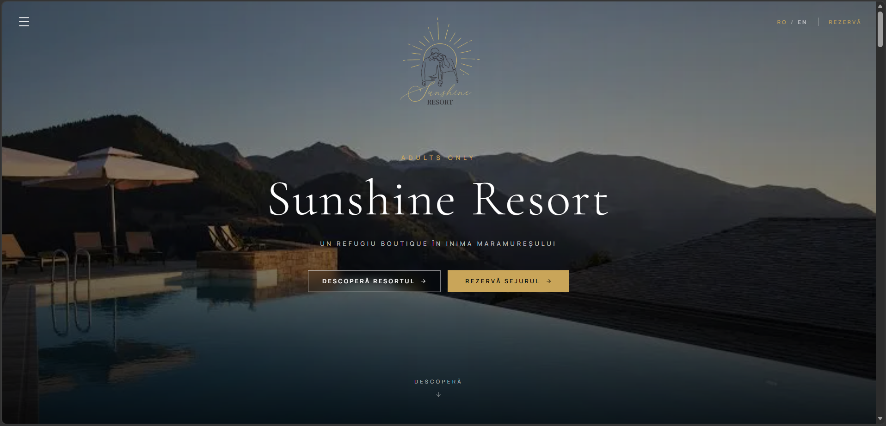
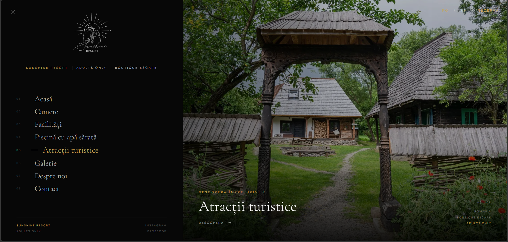
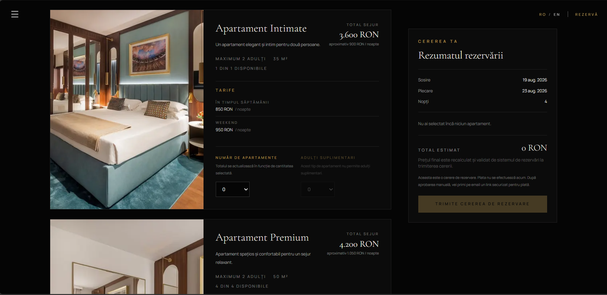
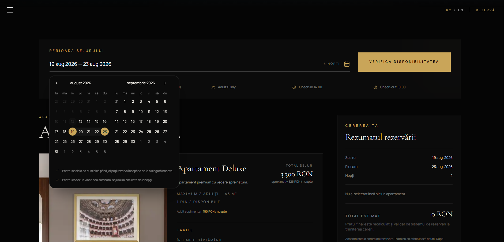
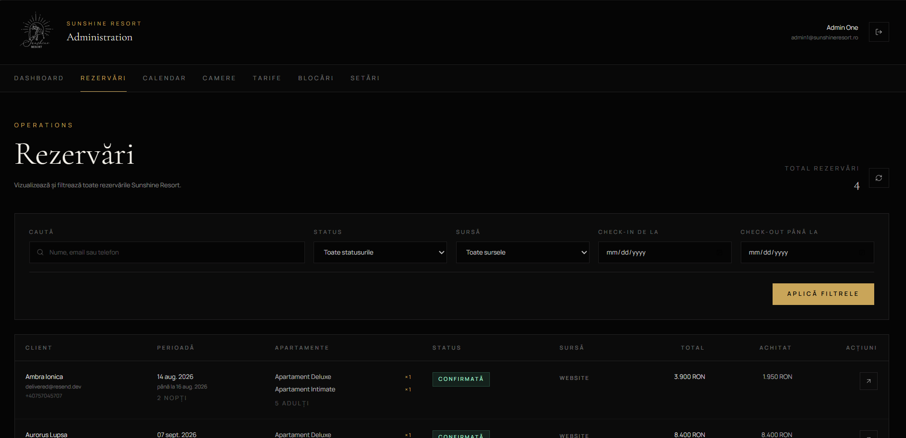
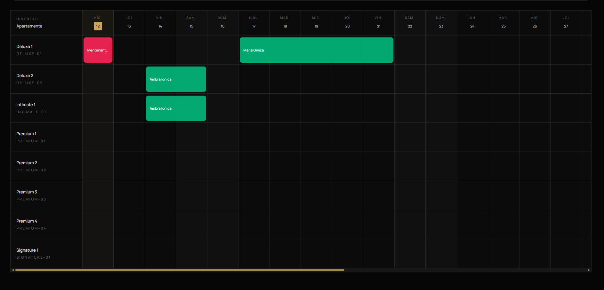
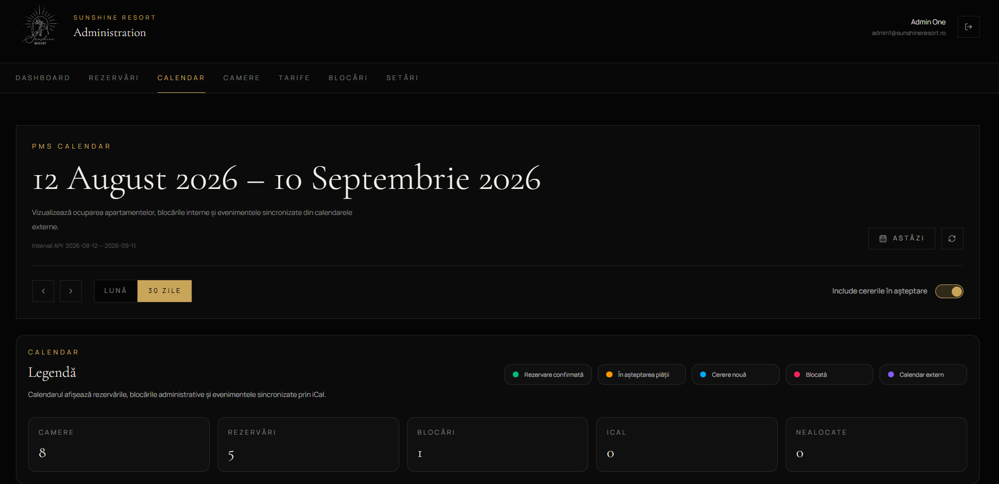
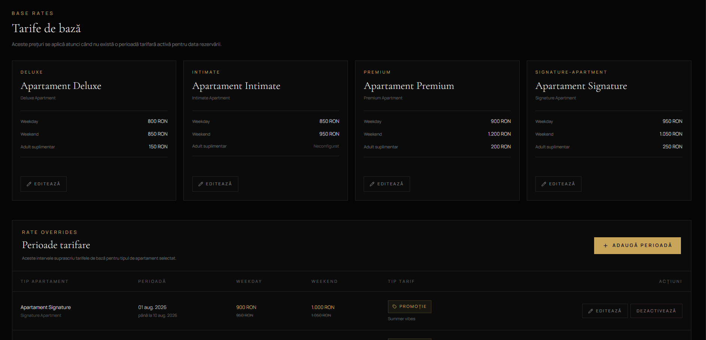

# Sunshine Resort

Full-stack booking and property management platform for a premium adults-only boutique resort.

Sunshine Resort combines a public hospitality website, a direct booking engine, an administrative Property Management System (PMS), online payments, automated reservation workflows, and guest communication in a single application.

> **Status:** Active development — core booking, payment, administration, and deployment infrastructure is functional.

## Live Demo

**Website:** https://sunshine-resort-web.vercel.app

The production deployment is currently used as a project preview while development continues.

> **Note:** The API is currently hosted on a free-tier service and may require a short cold start after a period of inactivity.

---

## Application Preview

### Public Website

The customer-facing application provides a responsive bilingual experience in Romanian and English, designed around the resort experience and direct reservations.



### Navigation

The public website includes responsive navigation, localized routes, and Romanian/English language switching.



### Booking Engine

Guests can search availability for their selected dates and guest configuration, compare available apartment categories, and continue through the direct reservation flow.



The booking flow handles accommodation selection, pricing, availability, guest information, and the transition into the reservation and payment lifecycle.



### Admin PMS

Sunshine Resort includes a custom Property Management System built specifically for the operational side of the resort.

It provides administrators with tools for managing reservations, rooms, availability, pricing, blocked periods, payments, and the reservation lifecycle.









---

## Overview

Sunshine Resort was designed as more than a presentation website.

The platform provides the infrastructure required to manage the booking lifecycle of a boutique resort with **8 apartments across 4 accommodation categories**.

The system consists of:

- Public bilingual website (Romanian / English)
- Real-time availability engine
- Direct booking flow
- Multi-room reservations
- Dynamic pricing
- Administrative Property Management System (PMS)
- Stripe payment integration
- Reservation lifecycle management
- Automated email notifications
- Room and availability management
- PostgreSQL persistence layer

The application follows a monorepo architecture with separate frontend and backend applications.

---

## System Architecture

```text
                        ┌─────────────────────────┐
                        │      Guest / Admin      │
                        └────────────┬────────────┘
                                     │
                                     ▼
                        ┌─────────────────────────┐
                        │       Next.js Web       │
                        │                         │
                        │  Public Website         │
                        │  Booking Engine         │
                        │  Admin PMS              │
                        └────────────┬────────────┘
                                     │
                                  REST API
                                     │
                                     ▼
                        ┌─────────────────────────┐
                        │       NestJS API        │
                        │                         │
                        │  Reservations           │
                        │  Availability           │
                        │  Payments               │
                        │  Authentication         │
                        │  Calendar               │
                        │  Notifications          │
                        │  Property Management    │
                        └───────┬─────────┬───────┘
                                │         │
                     ┌──────────┘         └──────────┐
                     ▼                               ▼
            ┌─────────────────┐            ┌─────────────────┐
            │ PostgreSQL      │            │ Stripe          │
            │ Prisma ORM      │            │ Checkout        │
            │ Supabase        │            │ Webhooks        │
            └────────┬────────┘            └─────────────────┘
                     │
                     │
            ┌────────▼────────┐
            │ Resend          │
            │ Transactional   │
            │ Email           │
            └─────────────────┘
```

---

## Core Features

### Public Website

The customer-facing application provides a responsive bilingual experience for discovering the resort and starting a direct reservation.

Features include:

- Romanian and English localization
- Apartment presentation
- Resort facilities
- Saltwater pool presentation
- Local attractions
- Gallery
- Contact information
- Responsive navigation
- Localized SEO-friendly public routes
- Direct booking entry points

### Booking Engine

Guests can check availability and create reservations directly through the website.

The booking system supports:

- Real-time availability queries
- Date-based pricing
- Weekday and weekend rates
- Seasonal rate periods
- Promotions
- Multiple apartment categories
- Multi-room reservations
- Extra adult pricing
- Minimum-stay validation
- Guest information collection
- Reservation price calculation
- Availability protection during the reservation lifecycle

Business rules are validated by the backend rather than relying exclusively on the client.

### Reservation Lifecycle

Reservations move through controlled states instead of being treated as simple database records.

A standard successful reservation follows this lifecycle:

```text
PENDING_APPROVAL
        │
        ▼
APPROVED_AWAITING_PAYMENT
        │
        ▼
CONFIRMED
        │
        ▼
CHECKED_IN
        │
        ▼
CHECKED_OUT
```

Additional states handle rejected, cancelled, and expired reservations.

Scheduled backend processes automatically handle time-sensitive reservation transitions and expirations.

### Payments

Stripe is integrated directly into the reservation workflow.

Implemented payment functionality includes:

- Stripe Checkout
- 50% deposit payments
- Full payments
- Payment status tracking
- Secure webhook processing
- Payment confirmation
- Refund tracking
- Reservation confirmation after successful payment

Payment state is persisted independently from reservation state to maintain a clear transaction history.

### Admin PMS

The project includes a custom administrative Property Management System rather than relying exclusively on third-party hotel software.

The PMS provides functionality for:

- Reservation management
- Manual reservations
- Reservation details
- Reservation modifications
- Room management
- Room type management
- Availability management
- Blocked periods
- Rate period management
- Reservation calendar
- Administrative dashboard
- Payment information
- Excel reservation export

Administrative routes are protected through authentication and authorization.

### Automated Communication

The backend contains a transactional email and notification layer for reservation-related communication.

The system supports automated messages associated with events such as:

- Reservation creation
- Reservation confirmation
- Payment workflow
- Pre-arrival reminders
- Check-in
- Check-out

---

## Tech Stack

### Frontend

- Next.js 16
- React
- TypeScript
- Tailwind CSS
- shadcn/ui
- Lucide Icons

### Backend

- NestJS
- TypeScript
- REST API
- Prisma ORM
- PostgreSQL
- JWT authentication
- bcrypt
- Scheduled jobs

### Payments

- Stripe Checkout
- Stripe Webhooks

### Communication

- Resend

### Infrastructure

- Vercel — frontend deployment
- Render — API deployment
- Supabase — managed PostgreSQL database

---

## Repository Structure

```text
sunshine-resort/
│
├── apps/
│   │
│   ├── api/
│   │   ├── prisma/
│   │   │   ├── migrations/
│   │   │   ├── schema.prisma
│   │   │   └── seed.ts
│   │   │
│   │   └── src/
│   │       ├── admins/
│   │       ├── auth/
│   │       ├── availability/
│   │       ├── blocked-periods/
│   │       ├── calendar/
│   │       ├── dashboard/
│   │       ├── email/
│   │       ├── payments/
│   │       ├── rate-periods/
│   │       ├── reservations/
│   │       ├── room-types/
│   │       └── rooms/
│   │
│   └── web/
│       └── src/
│           ├── app/
│           ├── components/
│           └── lib/
│
├── docs/
│   └── images/
│       ├── homepage.png
│       ├── navbar.png
│       ├── booking-01.png
│       ├── booking-02.png
│       ├── pms-01.png
│       ├── pms-02.png
│       ├── pms-03.png
│       └── pms-04.png
│
├── .gitignore
└── README.md
```

---

## Database

The application uses PostgreSQL with Prisma ORM.

The data model covers the main domains required by the reservation system, including:

- Administrators
- Guests
- Rooms
- Room types
- Reservations
- Reservation rooms
- Reservation changes
- Payments
- Rate periods
- Promotions
- Blocked periods
- Notification state

Database changes are versioned through Prisma migrations.

---

## Security

The application implements several backend security measures, including:

- Password hashing with bcrypt
- JWT-based admin authentication
- Protected administrative endpoints
- Request validation
- DTO whitelisting
- CORS restrictions
- Environment-based secrets
- Stripe webhook signature verification
- Server-side validation of reservation business rules

Sensitive credentials and production secrets are not stored in the repository.

---

## Deployment

The application is deployed across separate services:

```text
Frontend
Next.js
   │
   └── Vercel

Backend
NestJS
   │
   └── Render

Database
PostgreSQL
   │
   └── Supabase

Payments
   │
   └── Stripe

Transactional Email
   │
   └── Resend
```

Environment-specific configuration is provided through environment variables.

---

## Local Development

### API

```bash
cd apps/api
npm install
npx prisma generate
npm run start:dev
```

The API runs locally on:

```text
http://localhost:3001/api
```

### Web

```bash
cd apps/web
npm install
npm run dev
```

The web application runs locally on:

```text
http://localhost:3000
```

---

## Environment Variables

The project requires environment variables for database connectivity, authentication, payments, transactional email, and application URLs.

Example configuration:

```env
DATABASE_URL=
JWT_SECRET=
JWT_EXPIRES_IN=

STRIPE_SECRET_KEY=
STRIPE_WEBHOOK_SECRET=

RESEND_API_KEY=

FRONTEND_URL=
FRONTEND_BASE_URL=
```

Administrative credentials and other sensitive configuration are also supplied exclusively through environment variables.

Actual credentials and production secrets are intentionally excluded from the repository.

---

## Current Development

Sunshine Resort is an actively developed project.

Core functionality currently includes:

- Public bilingual website
- Booking engine
- Real-time availability
- Reservation lifecycle
- Dynamic rate management
- Stripe payment workflow
- PostgreSQL persistence
- Administrative PMS
- Reservation calendar
- Automated email infrastructure
- Production deployment

Further development focuses on additional PMS functionality, external booking-channel synchronization, production hardening, and UX refinements.

---

## Planned Integrations

The architecture is designed to support additional hospitality integrations, including:

- Booking.com synchronization through a compatible Channel Manager
- Extended administrative reporting
- Automated invoicing
- SMS notifications
- Smart TV welcome experience based on room assignment and reservation dates

---

## Engineering Focus

Sunshine Resort was built to address the engineering challenges of a real hospitality platform rather than functioning only as a visual hotel website.

Key engineering areas include:

- Full-stack TypeScript architecture
- Domain-oriented NestJS backend
- Transactional reservation workflows
- Real-time availability management
- Payment processing and webhook handling
- Relational data modelling
- Scheduled backend processes
- Administrative tooling
- Transactional communication
- Third-party API integration
- Production deployment

---

## Booking Workflow

The booking process is implemented as a multi-stage workflow rather than immediately confirming a reservation when a guest submits the booking form.

```text
Guest checks availability
        │
        ▼
Selects apartment(s)
        │
        ▼
Enters guest information
        │
        ▼
Reservation created
PENDING_APPROVAL
        │
        ├──────────────► Admin rejects
        │                   │
        │                   ▼
        │                REJECTED
        │
        ▼
Admin approves reservation
APPROVED_AWAITING_PAYMENT
        │
        ▼
Guest receives payment instructions
        │
        ▼
Chooses payment option
   ┌────┴────┐
   │         │
   ▼         ▼
50% deposit  Full payment
   │         │
   └────┬────┘
        ▼
Stripe Checkout
        │
        ▼
Stripe Webhook
        │
        ▼
Payment validated by NestJS API
        │
        ▼
Payment stored in PostgreSQL
        │
        ▼
Reservation
CONFIRMED
        │
        ▼
Confirmation email
        │
        ▼
Pre-arrival reminder
        │
        ▼
CHECKED_IN
        │
        ▼
CHECKED_OUT
```

Availability is protected throughout the relevant reservation states to reduce the risk of conflicting bookings.

Reservations that remain incomplete beyond their allowed time window are automatically processed by scheduled backend jobs.

Manual reservations can also be created directly from the Admin PMS without going through the public Stripe payment flow.

---

## Email & Notification Workflow

Transactional email is handled by the NestJS backend through Resend and is connected directly to reservation lifecycle events.

The communication layer is designed so that guest notifications are triggered by backend state changes rather than by frontend navigation.

Examples include:

```text
Reservation submitted
        │
        ├──► Guest reservation email
        │
        └──► Admin notification

Reservation approved
        │
        ▼
Guest payment email
        │
        ▼
Stripe payment completed
        │
        ▼
Webhook validated
        │
        ▼
Reservation confirmed
        │
        └──► Confirmation email

Approaching check-in
        │
        └──► Pre-arrival email

Reservation stay
        │
        ├──► Check-in lifecycle
        │
        └──► Check-out lifecycle
```

Scheduled jobs are used for time-dependent communication, while reservation and payment events trigger transactional messages associated with immediate state changes.

This keeps communication logic on the server and tied to persisted reservation state, rather than relying on the guest keeping the browser open or reaching a particular frontend page.


### Reservation Lifecycle

Reservations are modeled as an explicit state machine.

```text
                    PENDING_APPROVAL
                      /          \
                     /            \
                approve          reject
                   │                │
                   ▼                ▼
       APPROVED_AWAITING_PAYMENT  REJECTED
                   │
             successful payment
                   │
                   ▼
               CONFIRMED
                   │
                   ▼
              CHECKED_IN
                   │
                   ▼
              CHECKED_OUT
